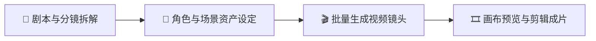
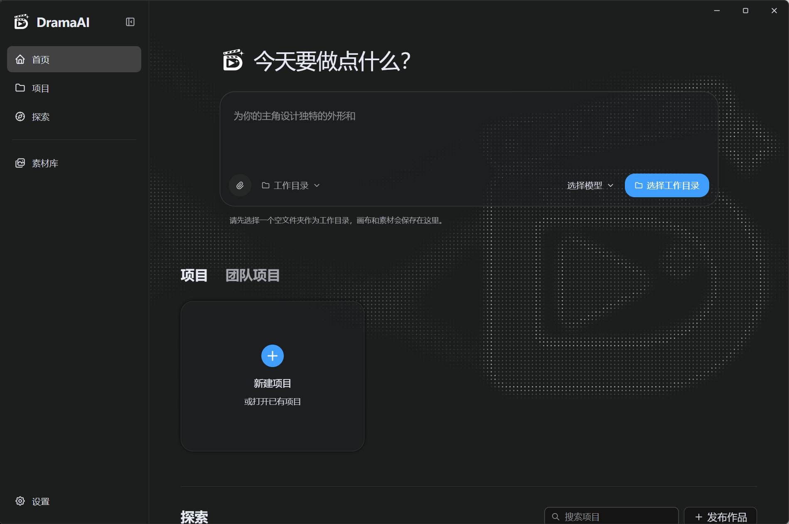
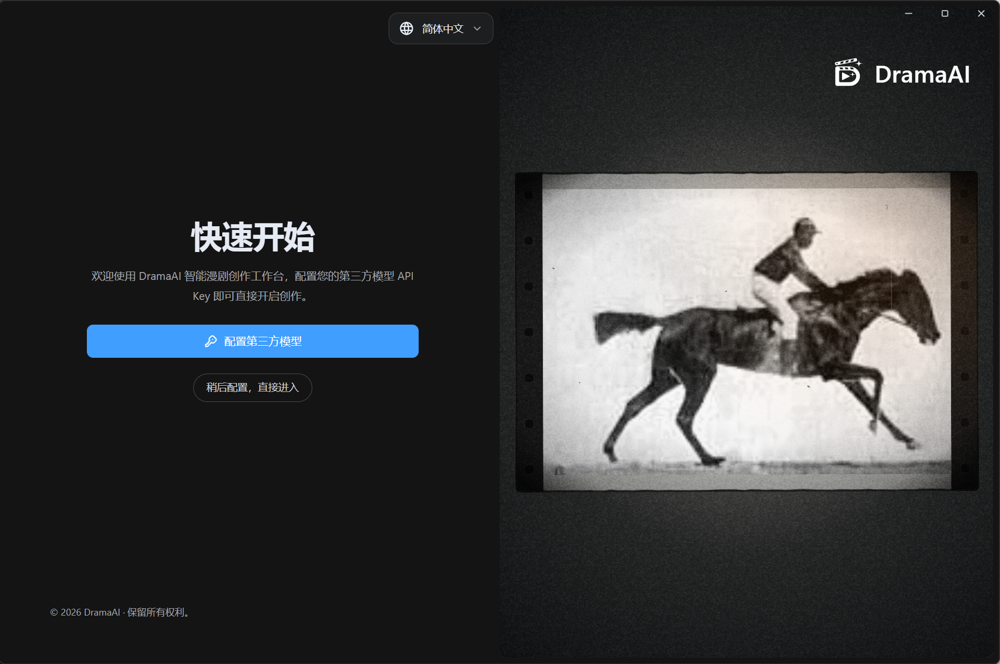

<p align="center">
  <strong>简体中文</strong> |
  <a href="./docs/readme/readmeZhTw.md">繁體中文</a> |
  <a href="./docs/readme/readmeEn.md">English</a> |
  <a href="./docs/readme/readmeJa.md">日本語</a> |
  <a href="./docs/readme/readmeRu.md">Русский</a> |
  <a href="./docs/readme/readmeVi.md">Tiếng Việt</a> |
  <a href="./docs/readme/readmeTh.md">ไทย</a>
  <br />
  <a href="./docs/readme/readmeKo.md">한국어</a> |
  <a href="./docs/readme/readmeHi.md">हिन्दी</a> |
  <a href="./docs/readme/readmeId.md">Bahasa Indonesia</a> |
  <a href="./docs/readme/readmeMs.md">Bahasa Melayu</a> |
  <a href="./docs/readme/readmeFil.md">Filipino</a> |
  <a href="./docs/readme/readmeBn.md">বাংলা</a> |
  <a href="./docs/readme/readmeUr.md">اردو</a>
  <br />
  <a href="./docs/readme/readmeTa.md">தமிழ்</a> |
  <a href="./docs/readme/readmeTe.md">తెలుగు</a> |
  <a href="./docs/readme/readmeMr.md">मराठी</a> |
  <a href="./docs/readme/readmePa.md">ਪੰਜਾਬੀ</a> |
  <a href="./docs/readme/readmeAr.md">العربية</a> |
  <a href="./docs/readme/readmeFa.md">فارسی</a> |
  <a href="./docs/readme/readmeTr.md">Türkçe</a>
</p>

> 🌐 **支持 21 种界面语言** · [查看支持的语言](#languages)

<div align="center">

<p align="center">
  
</p>

<h1 align="center">DramaAI｜开源与本地化 AI 短剧、漫剧与视频创作平台</h1>

<a href="https://git.io/typing-svg">
  <picture>
    <source media="(prefers-color-scheme: dark)" srcset="https://readme-typing-svg.demolab.com?font=Fira+Code&size=40&duration=3000&pause=1000&color=FFFFFF&center=true&vCenter=true&width=600&lines=DramaAI;AI%E7%9F%AD%E5%89%A7%E5%B7%A5%E5%8E%82;%E8%AE%A9%E7%81%B5%E6%84%9F%E6%88%90%E4%B8%BA%E7%9C8B%E5%BE%97%E8%A7%81%E7%9A%84%E6%95%85%E4%BA%8B" />
    
  </picture>
</a>

<p align="center">
  <a href="./LICENSE">
    
  </a>
  
  
</p>

<p align="center">
  &nbsp;
  &nbsp;
  &nbsp;
  
</p>

<p align="center">
  <strong>DramaAI</strong> 是面向短剧、漫剧和短视频创作者的本地化/桌面端 AI 创作平台（基于开源项目二次开发，遵循 MIT 协议）。<br />
  采用 <strong>BYOK（Bring Your Own Key，自带秘钥 / 本地算力）独立桌面客户端</strong> 模式：无强制订阅、无月费、无算力溢价。<br />
  通过无限画布编写剧本与分镜、管理角色三视图与场景资产、生成连贯图片与视频镜头。<br />
  支持直连本地 ComfyUI 独立显卡算力与国内外主流高性价比 API，提供 100% 本地隐私安全、离线创作能力与高扩展性 AI Agent 创作流。
</p>

<p align="center">
  <a href="#1-🌟-核心亮点">核心亮点</a> ·
  <a href="#2-🎬-如何用-dramaai-制作-ai-短剧与漫剧">创作流程</a> ·
  <a href="#3-💡-常见问题">常见问题</a> ·
  <a href="#4-📸-产品界面">产品界面</a> ·
  <a href="#5-🚀-下载与快速开始">下载与快速开始</a> ·
  <a href="#7-📜-开源许可与致谢">开源许可与致谢</a>
</p>

</div>

---

## 1. 🌟 核心亮点

DramaAI 把剧本创作、资产管理、分镜设计与视频生成全部整合进同一张无限画布：

| 能力维度 | 特性说明 |
| :--- | :--- |
| 🏠 **100% 本地隐私与安全** | 项目工程与生成资产完整保存在本地设备，彻底切断外部遥测与在线依赖，数据完全由创作者掌控。 |
| 🔑 **BYOK 自带秘钥 · 零月租** | 拒绝高昂的 SaaS 订阅费与算力代充溢价，自由配置第三方高性价比 API（硅基流动、可灵、海螺、OpenAI、DeepSeek 等），随用随充，成本透明直降 90%。 |
| ⚡ **本地 ComfyUI 显卡算力直连** | 支持直连本机独立显卡（RTX 3060/4070/4090 等）或局域网 ComfyUI 算力节点，0 边际成本无限生成角色图像与镜头视频。 |
| 🖼️ **无限创作画布** | 在同一张高自由度画布中可视化编排剧本文本、角色三视图、场景概念图、分镜脚本与镜头生成节点。 |
| 🤖 **开放 AI Agent & MCP** | 内置剧本拆解、分镜策划与镜头提示词辅助 Agent，支持通过 MCP（Model Context Protocol）协议与插件生态自由扩展创作能力。 |
| 📦 **开箱即用工程模板** | 预置爆款短剧工程模板与分镜提示词库（男频逆袭、女频穿书、豪门复仇等），3 分钟内跑通第一个短剧样片。 |
| 🌐 **21 种语言支持** | 原生支持简体中文、繁體中文、English 等全球 21 种界面语言。 |

---

## 2. 🎬 如何用 DramaAI 制作 AI 短剧与漫剧



1. **编写剧本与分镜**：在文本节点中整理故事大纲、角色小传与分镜台本，可调用语言模型辅助拆解分镜镜头、生成摄影机运动与画面提示词。
2. **准备角色与场景素材**：导入参考图或在画布中利用生图节点/本地 ComfyUI 批量生成角色三视图（正面/侧面/背面）、场景概念图与关键道具。
3. **生成连贯视频镜头**：将文本分镜节点与角色/场景参考图连线，选择视频生成模型（支持文生视频、图生视频、首尾帧控镜等），批量并发生成镜头片段。
4. **预览、整理与导出**：在无限画布中实时回放、对齐分镜顺序，一键导出全部视频资产或连贯预览，轻松衔接剪辑软件完成成片输出。

---

## 3. 💡 常见问题

<details>
<summary><strong>Q1: 为什么 DramaAI 采用 BYOK（自带秘钥）模式？</strong></summary>

市面上多数 AI 创作工具采用 SaaS 月租或点数包模式，除了软件费用外往往还有极高的算力溢价。DramaAI 采用客户端独立运行模式，用户直接在设置面板中填入第三方模型 API Key（如硅基流动、可灵、Fal.ai 等），或直接连接本地显卡。算力成本直接支付给服务商，绝无中间抽成与隐藏费用。
</details>

<details>
<summary><strong>Q2: 没有独立显卡也能使用 DramaAI 吗？</strong></summary>

可以。DramaAI 完整支持接入国内外主流高性价比云端 API 服务商。只需在设置面板中填入对应服务商的 API Key 即可快速开始创作；对于拥有 RTX 3060 及以上显卡的用户，更可启用本地 ComfyUI 享受零边际成本的无限出图生视频体验。
</details>

<details>
<summary><strong>Q3: 创作的数据和素材会上传到云端服务器吗？</strong></summary>

不会。DramaAI 经过彻底的隐私纯净化改造，切断了原版所有外部遥测与无意义的数据上报。您的剧本、分镜图、生成视频及工程工程文件均 100% 存储于本机指定的工作目录中，断网状态下亦可正常使用核心功能。
</details>

<details>
<summary><strong>Q4: DramaAI 支持哪些语言？</strong></summary>

<a id="languages"></a>
原生支持 21 种语言：简体中文、繁體中文、English、日本語、Русский、Tiếng Việt、ไทย、한국어、हिन्दी、Bahasa Indonesia、Bahasa Melayu、Filipino、বাংলা、اردو、தமிழ்、తెలుగు、मराठी、ਪੰਜਾਬੀ、العربية、فارسی、Türkçe。
</details>

---

## 4. 📸 产品界面

<div align="center">

<a href="./docs/images/screenshots/projectHome.png"></a><br /><sub>项目首页与灵感创作</sub>

<a href="./docs/images/screenshots/quickStart.png"></a><br /><sub>首次启动与快速配置</sub>

<a href="./docs/images/screenshots/canvasDark.png"></a><br /><sub>创作画布 · 深色主题</sub>

<a href="./docs/images/screenshots/canvasLight.png"></a><br /><sub>创作画布 · 浅色主题</sub>

<a href="./docs/images/screenshots/assetCanvas.png"></a><br /><sub>角色、场景与道具资产</sub>

<a href="./docs/images/screenshots/directorStudio.png"></a><br /><sub>3D 导演台与镜头预演</sub>

<a href="./docs/images/screenshots/characterImageGeneration.png"></a><br /><sub>角色三视图与图片生成</sub>

<a href="./docs/images/screenshots/videoGeneration.png"></a><br /><sub>多参考素材视频生成</sub>

<a href="./docs/images/screenshots/nodeMenu.png"></a><br /><sub>节点菜单与分组操作</sub>

<a href="./docs/images/screenshots/pluginMarket.png"></a><br /><sub>插件市场</sub>

</div>

---

## 5. 🚀 下载与快速开始

### 5.1 桌面客户端安装

| 操作系统 | 安装包类型 | 适用环境与架构 |
| :--- | :--- | :--- |
| **Windows** | `DramaAI-版本号-Setup.exe` | Windows 10/11 x64（Intel / AMD 处理器） |
| **Windows ARM64** | `DramaAI-版本号-win-arm64-Setup.exe` | 骁龙等 Windows 11 ARM64 设备 |
| **macOS Apple Silicon** | `DramaAI-版本号-macos-arm64.dmg` | M1 / M2 / M3 / M4 系列芯片（macOS 14+） |
| **macOS Intel** | `DramaAI-版本号-macos-x64.dmg` | Intel 处理器 Mac（macOS 14+） |
| **Linux** | `DramaAI-版本号-linux-x64.deb` | Ubuntu / Debian x64 系统 |

> **提示**：
> - Windows 安装器会自动检测并准备 WebView2 运行时；若启动异常，请确保系统已安装最新 Microsoft Edge WebView2 Runtime。
> - macOS 用户若打开时遇到系统安全提示，请前往“系统设置 → 隐私与安全性”点击“仍要打开”。

---

### 5.2 开发者源码运行

本项目推荐使用 [Bun 1.4.4](https://bun.sh/) 作为底层运行时与包管理器：

```bash
# 1. 克隆代码仓库
git clone https://github.com/YourOrg/DramaAI.git
cd DramaAi

# 2. 安装项目依赖
bun install

# 3. 运行桌面客户端开发模式
bun run dev:desktop

# 或运行 Web + Server 服务端模式
bun run dev:server
```

桌面构建完成后，亦可通过以下命令打包桌面安装包：

```bash
bun run package:desktop
```

---

### 5.3 Docker 部署（可选服务端模式）

若希望将 DramaAI 部署于私有服务器或远程 NAS：

```bash
# 构建并启动服务
docker compose up -d --build

# 访问本地 Web 创作端
http://127.0.0.1:3000
```

配置与项目资产将持久化挂载于 Docker 数据卷 `toonflowData`（`/app/data/`）。

---

## 6. 🎬 作品案例参考

| 维度 | 案例实测记录 |
| :--- | :--- |
| **制作周期与成片** | 约 2 小时，成片约 2 分钟短剧片段。 |
| **视频生成模型** | Seedance 2.0 / Kling / 混元 |
| **图片生成模型** | GPT Image 2 / FLUX / SDXL (ComfyUI) |
| **语言生成模型** | Claude Opus / DeepSeek V3 / Qwen |
| **API 调用成本** | 约 ¥20 ~ ¥60（若关键生图采用本地 ComfyUI，成本进一步降低） |

---

## 7. 📜 开源许可与致谢

### 开源许可证
DramaAI 遵循 [MIT 许可证](./LICENSE) 进行开源与分发。

### 溯源与致谢
- **上游基础**：本项目基于优秀开源项目 [Toonflow](https://github.com/HBAI-Ltd/Toonflow-app) 进行二次开发与独立维护，严格遵循原项目 MIT 开源许可证。在此对原作者团队及所有社区贡献者致以崇高的敬意与感谢。
- **生态技术**：感谢 Bun、Electrobun、Vue 3、ComfyUI、ThorVG 及广大开源生态为本项目提供的坚实基石。

<div align="center">

Copyright © 2026 DramaAI Team. All rights reserved.

</div>


