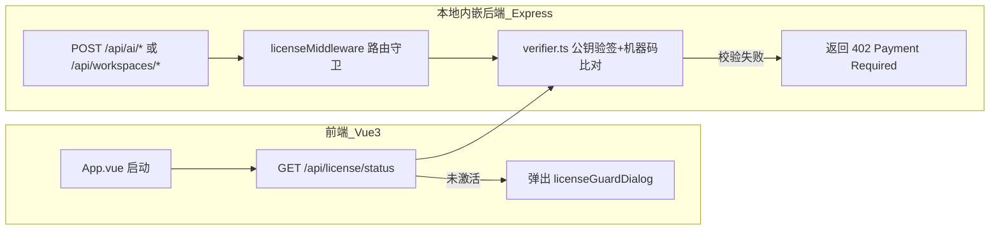

# DramaAI 技术设计文档（TDD）

- **关联文档**：[01_产品需求文档_PRD.md](./01_产品需求文档_PRD.md)
- **技术栈**：Bun 1.4.4 + Electrobun 2.0.5 + Vue 3.5 + Express 5 + SQLite (`better-sqlite3`) + Cloudflare Worker & D1
- **架构原则**：外挂式低侵入设计（最大化降低未来 `git merge upstream-sync` 时的冲突概率）

---

## 一、代码改动全量映射表（精准到文件与行号）

为确保上游代码合并顺畅，所有改动分为 **“最小化原文件修改”** 与 **“独立新增模块”** 两类：

### 1.1 原文件最小化修改清单

| 分类 | 文件路径 | 行号定位 | 具体修改内容 |
| :--- | :--- | :--- | :--- |
| **品牌配置** | [`electrobun.config.ts`](file:///e:/个人项目/AiDrama/DramaAi/electrobun.config.ts#L11-L16) | L11-L16 | `name: "DramaAI"`，`identifier: "com.dramaai.desktop"`，`urlSchemes: ["dramaai"]` |
| **更新源切断(1)** | [`electrobun.config.ts`](file:///e:/个人项目/AiDrama/DramaAi/electrobun.config.ts#L78-L83) | L78-L83 | 将 `release.baseUrl` 默认仓库从 `HBAI-Ltd/Toonflow-app` 改为 `jiang225638/DramaAi` |
| **更新源切断(2)** | [`apps/server/src/utils/desktop/index.ts`](file:///e:/个人项目/AiDrama/DramaAi/apps/server/src/utils/desktop/index.ts#L9-L12) | L9-L12 | 将 `updateBaseUrls.official` 和 `github` 统一指向自有更新地址，彻底切断 `api.toonflow.net/web/version/desktopUpdates` |
| **遥测上报切断** | [`apps/web/src/lib/anonymousData.ts`](file:///e:/个人项目/AiDrama/DramaAi/apps/web/src/lib/anonymousData.ts#L140-L155) | L140-L155 | 将 `reportAnonymousData` 改造为空操作（直接 `return`），并将 [`settings.ts`](file:///e:/个人项目/AiDrama/DramaAi/apps/web/src/stores/settings.ts#L91) 中 `dataCollectionEnabled` 默认设为 `false` |
| **Windows构建元信息** | [`apps/desktop/scripts/build.ts`](file:///e:/个人项目/AiDrama/DramaAi/apps/desktop/scripts/build.ts#L79-L89) | L79-L89 | 将 C# 助手编译生成的 `AssemblyTitle`、`AssemblyProduct`、`AssemblyCompany` 从 `Toonflow / HBAI-Ltd` 改为 `DramaAI` |
| **Windows安装包名** | [`apps/desktop/scripts/packageWindows.ts`](file:///e:/个人项目/AiDrama/DramaAi/apps/desktop/scripts/packageWindows.ts#L17) | L17 | 将硬编码的 `toonflow-${desktopConfig.app.version}...` 改为 `${desktopConfig.app.name}-${desktopConfig.app.version}...` |
| **NSIS安装器属性** | [`apps/desktop/installer/installer.nsi`](file:///e:/个人项目/AiDrama/DramaAi/apps/desktop/installer/installer.nsi#L9-L17) | L9-L17 | 修改 `!define appName "DramaAI"` 及 `CompanyName`、`FileDescription`、`MUI_FINISHPAGE_RUN_TEXT` |
| **网页根标题** | [`apps/web/index.html`](file:///e:/个人项目/AiDrama/DramaAi/apps/web/index.html#L7) | L7 | `<title>DramaAI</title>` |
| **设置面板精简** | [`apps/web/src/components/settings/index.vue`](file:///e:/个人项目/AiDrama/DramaAi/apps/web/src/components/settings/index.vue#L64-L97) | L64-L97 | 隐藏原版绑定 `api.toonflow.net` 的 `account`（官方账号钱包）面板，新增 `license`（软件授权激活）面板 |
| **赞助推广清理** | [`apps/server/src/app.ts`](file:///e:/个人项目/AiDrama/DramaAi/apps/server/src/app.ts#L16) 及 `packages/providers/src/media/*` | L16 | 移除或替换 `apiMart.ts`、`metaso.ts`、`compshare.ts` 中的原作者推广后缀（`?s=toon`、`ytag=`） |

### 1.2 独立新增外挂模块清单（零合并冲突）

```
DramaAi/
├── cloudflare-license-worker/                # [新增] 独立部署到 Cloudflare Worker 的卡密服务端工程
│   ├── schema.sql                            # D1 数据库初始化脚本
│   ├── wrangler.toml                         # Cloudflare 部署配置
│   └── src/index.ts                          # 激活、验签、解绑、批量制卡接口实现
├── apps/server/src/utils/license/            # [新增] 客户端内嵌后端授权校验模块
│   ├── machineId.ts                          # 跨平台稳定硬件指纹提取 (RegQuery / IOPlatformUUID)
│   ├── verifier.ts                           # Ed25519 公钥离线验签、防时间回拨校验、本地凭证读写
│   └── middleware.ts                         # Express 路由拦截中间件 (未激活拦截 AI 生成与导出接口)
└── apps/web/src/components/license/          # [新增] 前端激活弹窗与设置页授权状态组件
    ├── licenseGuardDialog.vue                # 启动强拦截激活弹窗
    └── licenseSettingsPanel.vue              # 设置页内的授权信息查看与“本机解绑”面板
```

---

## 二、卡密授权与验证系统详细设计（Cloudflare Worker + D1）

### 2.1 密码学签名方案选型：Ed25519
相比传统 RSA-2048，**Ed25519** 具备密钥短、签名体积极小、且在 Cloudflare Worker Web Crypto API 与 Bun/Node.js `node:crypto` 中均原生支持的优势。
- **私钥 (`ED25519_PRIVATE_KEY`)**：仅保存在 Cloudflare Worker 的加密环境变量（Secret）中，用于签发激活凭证。
- **公钥 (`ED25519_PUBLIC_KEY`)**：硬编码在客户端 `apps/server/src/utils/license/verifier.ts` 中，用于离线验证签名真伪，任何人均无法伪造签名。

### 2.2 跨平台稳定机器码（`machineId`）提取方案
摒弃在新版 Windows 11 中已移除的 `wmic` 命令，采用系统底层原生标识并进行 SHA-256 归一化：
- **Windows**：读取注册表 `HKEY_LOCAL_MACHINE\SOFTWARE\Microsoft\Cryptography` 下的 `MachineGuid`（通过 `reg.exe query` 获取）。
- **macOS**：通过 `ioreg -rd1 -c IOPlatformExpertDevice` 读取 `IOPlatformUUID`。
- **Linux**：读取 `/etc/machine-id`。
- **哈希计算**：`sha256("dramaai-salt:" + rawPlatformGuid).slice(0, 32)`，生成固定 32 位十六进制机器码。

### 2.3 Cloudflare D1 数据库表结构（修正完备版）

针对首次激活计期、到期计算、状态流转与防回拨进行完整建模：

```sql
-- 1. 卡密主表
CREATE TABLE IF NOT EXISTS licenses (
    id INTEGER PRIMARY KEY AUTOINCREMENT,
    card_key TEXT UNIQUE NOT NULL,             -- 格式如: DRAMA-PRO-8F9A-2C1D-7E3B
    tier TEXT NOT NULL CHECK(tier IN ('lifetime', 'monthly', 'yearly')),
    duration_days INTEGER NOT NULL DEFAULT 0,  -- lifetime=0, monthly=30, yearly=365
    max_devices INTEGER NOT NULL DEFAULT 1,    -- 允许同时绑定的设备数上限 (买断/年卡可设为2)
    status TEXT NOT NULL DEFAULT 'unused' CHECK(status IN ('unused', 'active', 'expired', 'banned')),
    first_activated_at INTEGER,                -- 首次激活的毫秒时间戳 (由此起算有效期!)
    expires_at INTEGER,                        -- 授权到期毫秒时间戳 (lifetime 为 NULL)
    note TEXT,                                 -- 批次号或订单备注
    created_at INTEGER NOT NULL                -- 创建毫秒时间戳
);

-- 2. 设备绑定表
CREATE TABLE IF NOT EXISTS activations (
    id INTEGER PRIMARY KEY AUTOINCREMENT,
    card_key TEXT NOT NULL,
    machine_id TEXT NOT NULL,                  -- 32位硬件指纹哈希
    device_name TEXT,                          -- 设备主机名 (os.hostname())
    platform TEXT,                             -- win32 / darwin / linux
    activated_at INTEGER NOT NULL,
    last_verified_at INTEGER NOT NULL,
    FOREIGN KEY(card_key) REFERENCES licenses(card_key) ON DELETE CASCADE,
    UNIQUE(card_key, machine_id)
);

CREATE INDEX IF NOT EXISTS idx_licenses_card_key ON licenses(card_key);
CREATE INDEX IF NOT EXISTS idx_activations_card_key ON activations(card_key);
```

#### 卡密生命周期与计期规则：
1. **制卡阶段 (`unused`)**：批量生成时 `status = 'unused'`，`first_activated_at = NULL`，`expires_at = NULL`。卡密放在发卡网不管放多久，**只要买家没激活，有效期一秒都不会损耗**。
2. **首次激活 (`unused` ➔ `active`)**：
   - 记录 `first_activated_at = Date.now()`；
   - 若 `tier === 'lifetime'`，则 `expires_at = NULL`；
   - 若为周期卡，则 `expires_at = first_activated_at + duration_days * 86400_000`。
3. **周期到期 (`active` ➔ `expired`)**：当 `expires_at !== null && Date.now() > expires_at` 时，自动判定过期。

### 2.4 离线凭证（License Token）数据结构与防篡改策略

激活或续签成功时，Worker 生成如下 Payload 并用 Ed25519 私钥签名：

```ts
interface LicenseTokenPayload {
  v: 1;                          // 协议版本
  cardKey: string;               // 脱敏或完整卡密
  machineId: string;             // 绑定的硬件机器码
  tier: "lifetime" | "monthly" | "yearly";
  issuedAt: number;              // 本次凭证签发时间 (ms)
  licenseExpiresAt: number | null; // 卡密本身的到期时间 (lifetime 为 null)
  offlineValidUntil: number;     // 离线最长免联网宽限期截止时间 (ms)
}
```

#### 双层有效期与防系统时间回拨机制：
1. **离线宽限期 (`offlineValidUntil`)**：
   - `lifetime` 买断卡：`issuedAt + 180 * 86400_000`（半年内完全断网也能用，有网时静默刷新顺延）；
   - `monthly / yearly` 订阅卡：`Math.min(licenseExpiresAt, issuedAt + 14 * 86400_000)`（最长允许连续断网 14 天，有网启动时自动静默调用 `/api/license/verify` 刷新顺延）。
2. **防系统时间回拨（Anti-Clock-Rollback）**：
   - 客户端本地持久化记录 `lastKnownTimestamp`（每次启动、每次 API 调用时若 `Date.now() > lastKnownTimestamp` 则更新该值）；
   - 若检测到当前系统时间 `Date.now() < lastKnownTimestamp - 3600_000`（系统时间被人为往回调了超过 1 小时），立即判定本地离线凭证失效，强制要求联网重新校验服务器标准时间。

### 2.5 前后端双层拦截架构（杜绝单纯修改前端绕过）



- 即使攻击者通过浏览器控制台删除前端弹窗 DOM，只要未通过本地后端 `verifier.ts` 的 Ed25519 公钥签名与机器码核验，所有 `/api/ai/generate`、`/api/ai/media/generate` 请求均会被 Express 中间件直接拦截返回 `402 请先激活软件`。

### 2.6 Cloudflare Worker 接口规范与限流防护

| 接口路径 | 方法 | 用途 | 限流与安全策略 |
| :--- | :---: | :--- | :--- |
| `/api/license/activate` | POST | 客户端输入卡密首次激活或新设备绑定 | 按客户端 IP 限流（每分钟最多 5 次失败尝试），防止暴力枚举卡密 |
| `/api/license/verify` | POST | 客户端启动时后台静默续签 Token | 校验卡密是否被封禁 (`banned`) 及设备是否仍在绑定列表中 |
| `/api/license/deactivate` | POST | 客户端主动解绑当前电脑 (`cardKey + machineId`) | 仅允许已绑定的 `machineId` 解绑自身记录，释放设备槽位 |
| `/admin/license/generate` | POST | 管理员批量生成卡密 | 强制校验 Header `Authorization: Bearer <ADMIN_SECRET>`，使用 `timingSafeEqual` 比对 |
| `/admin/license/reset` | POST | 管理员后台人工帮客户清空设备绑定 | 同上，用于客户电脑损坏无法自助解绑时的售后处理 |

---

## 三、内置高性价比供应商预设技术方案

### 3.1 语言模型（LLM）一键预设模板
在 [`apps/web/src/components/settings/panels/languageModel`](file:///e:/个人项目/AiDrama/DramaAi/apps/web/src/components/settings/panels/languageModel) 中新增预设字典 `presetLanguageProviders.ts`：

```ts
export const presetLanguageProviders = [
  {
    id: "siliconflow",
    label: "硅基流动 (SiliconFlow · 国内高性价比首选)",
    apiUrl: "https://api.siliconflow.cn/v1",
    protocol: "openai-completions",
    signupUrl: "https://cloud.siliconflow.cn",
    models: [
      { id: "deepseek-ai/DeepSeek-V3", label: "DeepSeek-V3 (剧本拆解主力)", contextWindow: 64000, maxOutputTokens: 8192 },
      { id: "deepseek-ai/DeepSeek-R1", label: "DeepSeek-R1 (深度推理分镜)", contextWindow: 64000, maxOutputTokens: 8192 },
      { id: "Qwen/Qwen2.5-72B-Instruct", label: "Qwen2.5-72B", contextWindow: 32768, maxOutputTokens: 4096 },
    ],
  },
  {
    id: "deepseek-official",
    label: "DeepSeek 官方开放平台",
    apiUrl: "https://api.deepseek.com/v1",
    protocol: "openai-completions",
    models: [
      { id: "deepseek-chat", label: "DeepSeek-V3", contextWindow: 64000, maxOutputTokens: 8192 },
      { id: "deepseek-reasoner", label: "DeepSeek-R1", contextWindow: 64000, maxOutputTokens: 8192 },
    ],
  },
  {
    id: "openrouter",
    label: "OpenRouter (出海全模型聚合)",
    apiUrl: "https://openrouter.ai/api/v1",
    protocol: "openai-completions",
    models: [
      { id: "anthropic/claude-3.5-sonnet", label: "Claude 3.5 Sonnet (欧美短剧剧本天花板)", contextWindow: 200000, maxOutputTokens: 8192 },
      { id: "openai/gpt-4o", label: "GPT-4o", contextWindow: 128000, maxOutputTokens: 16384 },
    ],
  },
];
```

---

## 四、构建、打包与上游同步标准操作流程（SOP）

### 4.1 桌面端一键打包命令（修正版）
[`apps/desktop/scripts/build.ts`](file:///e:/个人项目/AiDrama/DramaAi/apps/desktop/scripts/build.ts#L108-L121) 内部在 `package` 模式下已自动串联了 `tools/nodes/ext`、`apps/web`、`packages/mcp` 的生产构建，因此**无需重复手动执行前置构建命令**：

```powershell
# 1. 本地开发调试（前后端并发热重载）
bun run dev

# 2. 桌面端开发窗口联调
bun run dev:desktop

# 3. 生产环境一键生成 Windows NSIS 安装包 (.exe)
bun run package:desktop
```
- **产物输出路径**：`build/desktop/artifacts/DramaAI-2.0.0-Setup.exe`

### 4.2 同步上游开源更新 SOP
当原作者仓库 `HBAI-Ltd/Toonflow-app` 发布新稳定版 Tag 时：
```powershell
# 1. 切换至纯净镜像分支并拉取官方更新
git checkout upstream-sync
git pull upstream master

# 2. 切回商业主分支并合并
git checkout main
git merge upstream-sync

# 3. 重新编译内置插件并启动验证
bun run dev:plugins
bun run dev
```
