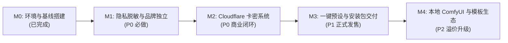

# DramaAI 任务进度与里程碑跟踪表

- **关联文档**：
  - [01_产品需求文档_PRD.md](./01_产品需求文档_PRD.md)
  - [02_技术设计文档.md](./02_技术设计文档.md)
- **最后更新时间**：2026-11-09

---

## 一、里程碑划分（Milestones）

---

## 二、任务执行看板（Task Board）

### 阶段 M0：仓库初始化与本地开发环境搭建（已完成）

| 任务 ID | 任务项 | 状态 | 完成说明 |
| :--- | :--- | :---: | :--- |
| **M0-1** | GitHub 私有仓库 `DramaAi` 创建与 SSH 推送 | 已完成 | 已绑定 `origin` (私有库) 与 `upstream` (官方库) |
| **M0-2** | 双分支体系（`main` + `upstream-sync`）血缘对齐 | 已完成 | 已对齐至共同祖先 `6086cdf`，后续 `git merge` 零历史冲突 |
| **M0-3** | 本地 Bun 1.4.4 与 Electrobun Devkit (`.hutch`) 安装 | 已完成 | 已修复类型报红，完成 964 个依赖包与内置插件编译 |
| **M0-4** | 修复 `package.json` 中 `bun run dev` 串行阻塞 Bug | 已完成 | 已添加 `--parallel` 参数，支持一条命令同时启动 Web 与 Server |

---

### 阶段 M1：隐私清理、更新源切断与品牌重塑（P0 · 已完成）

| 任务 ID | 任务项 | 优先级 | 状态 | 涉及核心文件 | 验收打勾 |
| :--- | :--- | :---: | :---: | :--- | :---: |
| **M1-1** | **关闭官方匿名遥测数据上报** | P0 | ✅ 已完成 | `apps/web/src/lib/anonymousData.ts` `apps/web/src/stores/settings.ts` `apps/web/src/components/settings/panels/about/privacy.vue` | [x] 网络面板无 `api.toonflow.net/web/telemetry` 请求，默认关闭统计 |
| **M1-2** | **切断双通道官方自动更新源** | P0 | ✅ 已完成 | `electrobun.config.ts` `apps/server/src/utils/desktop/index.ts` | [x] 检查更新不请求 `HBAI-Ltd` 与 `api.toonflow.net`，统一指向私有 Release |
| **M1-3** | **隐藏原版官方账号/钱包面板、内置模型卡片、设备互联、广告轮播与推广链接** | P0 | ✅ 已完成 | `apps/web/src/components/settings/index.vue` `apps/web/src/components/settings/panels/mediaModel/index.vue` `apps/web/src/components/settings/panels/languageModel/index.vue` `apps/web/src/components/settings/panels/pluginMarket/index.vue` `apps/web/src/pages/home/index.vue` `apps/web/src/pages/hello/index.vue` `apps/server/src/utils/channel/toonflow.ts` `packages/providers/src/media/*` `apps/web/src/pages/workspace/index.vue` | [x] 设置页隐藏官方充值/多租户/设备互联入口与内置官方模型卡片，插件市场去除官方在线市场/文档外链，屏蔽首页设备互联与官方广告，去除推广尾巴 |
| **M1-4** | **全局品牌重命名为 DramaAI（保留 MIT 声明）** | P0 | ✅ 已完成 | `README.md` `docs/readme.md` `electrobun.config.ts` `apps/web/index.html` `apps/desktop/src/index.ts` `apps/desktop/scripts/build.ts` `apps/desktop/scripts/packageWindows.ts` `apps/desktop/installer/installer.nsi` `apps/web/src/pages/home/index.vue` `apps/web/src/pages/hello/index.vue` `apps/web/src/components/settings/panels/about/index.vue` `apps/web/src/components/desktopQuit.vue` `apps/web/src/components/updateBox.vue` `apps/web/src/components/agent/conversation/messageList.vue` | [x] 仓库文档、网页标题、界面品牌、新手引导、关于页（含 MIT 开源致谢）、安装器名称与弹窗全部显示为 `DramaAI` |
| **M1-5** | **启动屏文字去重、全套图标替换与桌面端统一无边框顶部栏** | P1 | ✅ 已完成 | `packages/startup/assets/startup.json` `packages/startup/src/windowsSplash.ts` `apps/desktop/native/startupLauncher.cs` `packages/assets/logo.ico` `packages/assets/logo.svg` `packages/assets/logo.iconset/*` `docs/images/logo.png` `apps/web/src/components/desktopTitlebar.vue` `apps/web/src/lib/appearance.ts` | [x] 原生启动动画、Windows 启动器与全套图标已替换为 `DramaAI` 专属标识；桌面端移除系统原生标题栏并实现深浅色自适应的沉浸式统一顶部控制栏 |

---

### 阶段 M2：Cloudflare 卡密授权与激活系统（P0 · 待启动）

| 任务 ID | 任务项 | 优先级 | 状态 | 涉及核心文件 | 验收打勾 |
| :--- | :--- | :---: | :---: | :--- | :---: |
| **M2-1** | **生成 Ed25519 公私钥对并编写 Cloudflare Worker 工程** | P0 | ⏳ 待开始 | `cloudflare-license-worker/schema.sql` `cloudflare-license-worker/src/index.ts` | [ ] 完成激活、续签、解绑、批量制卡 4 个核心接口代码 |
| **M2-2** | **编写客户端跨平台机器码提取与离线验签模块** | P0 | ⏳ 待开始 | `apps/server/src/utils/license/machineId.ts` `apps/server/src/utils/license/verifier.ts` | [ ] 准确读取 Windows `MachineGuid` 并完成 Ed25519 验签与防回拨校验 |
| **M2-3** | **挂载本地 Server 授权路由与拦截中间件** | P0 | ⏳ 待开始 | `apps/server/src/utils/license/middleware.ts` `apps/server/src/router.ts` | [ ] 未激活状态下调用 AI 生成接口返回 402 拦截 |
| **M2-4** | **开发前端激活守卫弹窗与设置页解绑面板** | P0 | ⏳ 待开始 | `apps/web/src/components/license/licenseGuardDialog.vue` `apps/web/src/components/license/licenseSettingsPanel.vue` | [ ] 未激活自动弹窗拦截，输入卡密激活解锁，支持本机解绑 |
| **M2-5** | **部署 Cloudflare Worker + D1 并完成端到端联调** | P0 | ⏳ 待开始 | Cloudflare 控制台 | [ ] 真实生成测试卡密（买断/月卡），验证激活、断网重启、超设备拦截 |

---

### 阶段 M3：高性价比 API 一键预设与桌面安装包交付（P1 · 待启动）

| 任务 ID | 任务项 | 优先级 | 状态 | 涉及核心文件 | 验收打勾 |
| :--- | :--- | :---: | :---: | :--- | :---: |
| **M3-1** | **开发文本大模型一键预设下拉模板**（硅基流动/DeepSeek/OpenRouter） | P1 | ⏳ 待开始 | `apps/web/src/components/settings/panels/languageModel/` | [ ] 选择预设后仅填 API Key 即可一键添加供应商与模型 |
| **M3-2** | **执行 Windows 桌面安装包完整构建测试** | P1 | ⏳ 待开始 | `bun run package:desktop` | [ ] 成功产出 `DramaAI-2.0.0-Setup.exe` 且安装运行正常 |

---

### 阶段 M4：本地 ComfyUI 节点与短剧模板包（P2 · 增值迭代）

| 任务 ID | 任务项 | 优先级 | 状态 | 涉及核心文件 | 验收打勾 |
| :--- | :--- | :---: | :---: | :--- | :---: |
| **M4-1** | **接入本地 ComfyUI (`127.0.0.1:8188`) 媒体供应商适配** | P2 | ⏳ 待开始 | `packages/providers/src/media/comfyuiLocal.ts` | [ ] 本地开启 ComfyUI 后可在画布节点直接调用生图 |
| **M4-2** | **制作 2 套开箱即用短剧示范画布工程** | P2 | ⏳ 待开始 | 内置示例模板目录 | [ ] 新用户打开即可一键载入示例短剧分镜工作流 |

---

## 三、上游版本同步记录表

| 同步日期 | 上游版本 / Commit | 合并执行人 | 冲突文件数 | 备注 |
| :--- | :--- | :--- | :---: | :--- |
| 2026-11-05 | `6086cdf` (v2.0.10+) | 初始对齐 | 0 | 完成 `main` 与 `upstream-sync` 基线对齐 |
